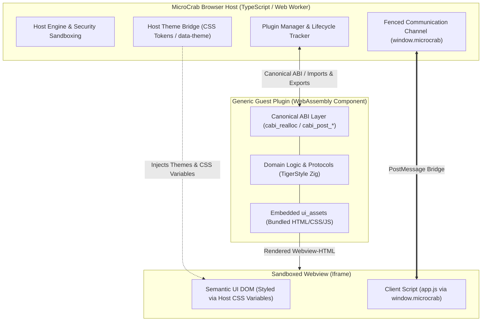
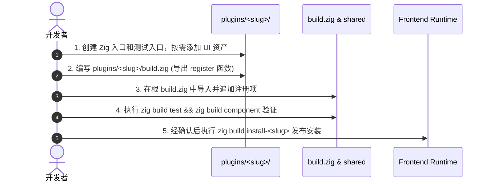

# MicroCrab Frontend Plugins (Zig Edition) 技术与架构规范

本文档为 MicroCrab 浏览器端 WebAssembly Component 插件的**通用技术规范与架构白皮书**。
所有基于 Zig 开发的前端插件（包括当前已实现插件以及未来扩充的任意类型插件），均必须严格遵循本规范所定义的沙箱边界、编码规范、UI构造机制、传输协议与编译发布管线。

---

## 1. 架构总览与系统设计目标

MicroCrab 前端插件运行于现代浏览器的 WebAssembly Component Model 运行时环境之上，以最小特权、纯净隔离和强类型契约为核心。



### 1.1 核心设计目标
1. **完全等价且严谨的 WIT 契约**：严格遵循 `microcrab:client-plugin@0.4.0` WIT 规范，组件间互操作基于 Canonical ABI；
2. **纯净的 Freestanding 沙箱**：编译目标严格锁定为 `wasm32-freestanding`，零外部 libc 依赖，零宿主操作系统调用，杜绝非受控 WASI 适配层；
3. **安全隔离的 Webview-HTML 方案**：采用内联离线打包的 `webview-html` 渲染模型，彻底替代脆弱的远端脚本或静态 AST 树；
4. **强健的 TigerStyle 安全哲学**：遵循 **Safety > Performance > Developer Experience** 优先级，显式资源管理与有界计算；
5. **高度可扩展的模块化架构**：各插件通过根构建文件统一注册，通用基础设施抽象至 `shared` 库。

---

## 2. 插件边界与安全沙箱 (Plugin Boundaries & Security Sandboxing)

前端插件运行在浏览器受限环境中，必须恪守严格的安全沙箱与最小权限边界。

### 2.1 WIT World 权限模型与最小特权原则
插件必须根据自身功能诉求，从 [WIT 镜像](<wit/client-plugin.wit>) 中选用**最小且必要**的 World，严禁随意引入未授权的宿主能力：

| WIT World | 导入接口 (Host Imports) | 导出接口 (Exports) | 适用通用插件类型 |
| :--- | :--- | :--- | :--- |
| `fixture` | 无宿主导入 | `plugin-exports` | 无需环境交互的纯算法、基准测试或行为演示插件 |
| `surface-fixture` | `conversation` | `plugin-exports` | 会话只读装饰、消息元数据展示类插件 |
| `state-viewer` | `session-state`, `session-state-write` | `plugin-exports` | 会话状态查看、上下文变量受控编辑类插件 |
| `output-translator`| `conversation`, `storage`, `net`, `resources` | `plugin-exports` | 文本翻译、内容结构增强、端点代理类插件 |
| `tool-plugin` | `net`, `resources` | `plugin-exports`, `start-tool`, `cancel-tool` | 外部工具提供者、MCP 服务器桥接、执行代理类插件 |
| `client-plugin` | `session-state`, `session-state-write`, `net`, `conversation`, `storage`, `session-manager` | `plugin-exports` | 通用客户端扩展 |

### 2.2 宿主导入接口契约 (Host Imports)
- `session-state`：只读读取当前会话状态、变量及元数据；
- `session-state-write`：发起状态变更或变量补丁，需要宿主与所有权鉴权；
- `net`：受控 HTTP/网络请求（仅限清单声明的 origins 或经用户显式授权保存的 endpoints）；
- `resources`：宿主托管的凭证与受控外部服务通信；
- `storage`：插件私有键值存储（只隔离存储非敏感配置）；
- `conversation`：获取已完结会话块（Settled blocks）数据；
- `session-manager`：通过 `sessions()` 和 `projects()` 返回字符串。

`request` 导入排队处理，立即通过 `result<u32, string>` 返回句柄或错误，完成结果通过 `on-phase("event-result", ...)` 回传。`storage.get` 同步返回 `option<string>`，`storage.set` 和 `storage.remove` 同步返回 `result<u32, string>`。

### 2.3 机密数据与 Secret 变量安全边界
1. **只读掩码呈现**：
   - 当变量元数据声明 `visibility: "secret"` 时，插件只能展示其 Key 与只读/掩码状态；
   - 严禁尝试读取、反查、解密、推断或回显 Secret 变量的明文值；
   - 严禁向模型投影提供 Secret 明文；
2. **禁止持久化与广播**：
   - Secret 明文或凭据严禁写入插件私有 Storage、浏览器本地缓存、长期 Vars 或诊断日志；
   - 严禁将 Secret 明文传递给未经授权的外部端点；
3. **内存原位清零**：
   - 敏感认证头或用户输入的临时凭据（如 Auth Token），在解析或单次使用完毕后，必须使用 `WipingAllocator` 或 `std.crypto.utils.secureZero` 原位彻底擦除内存；
4. **受控删除权**：
   - 仅当 Core 状态描述符明确赋予 `deletable` 且持有 Client ownership 时，方允许发起删除操作，且删除动作仅提交变量名与 Mutation Witness，绝不提交变量值。

### 2.4 资源配额与有界预算
为保障宿主浏览器的流畅度与稳定性，所有通用插件必须实施确定性的资源预算上限：
- **内存配额**：插件整体运行内存受限（例如通过自定义 `Budget` 分配器限制在 2 MiB ~ 16 MiB 之间，超出即拒绝分配并向宿主返回显式错误）；
- **任务并发限制**：网络与异步请求严格设限（如单个会话最多 4 个并发网络任务、32 个并发工具调用槽位）；
- **有界缓存与 LRU 淘汰**：内部保留的会话块历史、工具调用记录必须设置固定容量上限（例如 128 条或 256 条），达到上限时必须按 LRU 或 Terminal-first 策略淘汰，严禁无限制内存堆积；
- **时限快照 (Timeout Snapshot)**：插件调用网络或外部服务时，必须捕获宿主提供的 `host_http_timeout_ms`（10,000 ~ 300,000 ms），并在超时后释放本地资源槽位，严禁孤儿任务无限驻留。

---

## 3. 代码注意事项与 TigerStyle 规范

所有插件的 Zig 代码均严格遵循 TigerStyle 编码哲学：**Safety > Performance > Developer Experience**。

### 3.1 显式内存分配与生命周期
- **禁止隐式全局堆**：所有需要内存分配的函数必须显式接受 `std.mem.Allocator`；
- **规范分配器选用**：
  - 基础 Wasm 分配器：`shared.abi.allocator`（即 `std.heap.wasm_allocator`）；
  - 临时作用域与请求生命周期：使用 `std.heap.ArenaAllocator`，生命周期结束时统一 `arena.deinit()`；
  - 敏感数据作用域：使用自定义 `WipingAllocator`，在释放时自动填充零值；
- **Canonical ABI 内存契约**：
  - 导出的 `cabi_realloc` 必须严格遵循 WebAssembly Canonical ABI 规范；
  - 宿主从 Guest 提取返回数据后，会调用对应的 `cabi_post_*` 钩子。插件必须在该钩子中精准释放分配的返回缓冲区，严禁提前释放或永久泄漏。

### 3.2 防御式断言与控制流
- **正向状态断言**：断言必须检测程序员逻辑错误。在函数入口处显式断言入参有效性；
- **成对断言 (Pair Assertions)**：对于核心状态变更，在写入前和读回后均进行断言校验；
- **编译期断言**：使用 `comptime assert` 校验结构体大小、内存对齐与常量关系：
  ```zig
  comptime assert(@sizeOf(ManifestBuffer) == 56);
  comptime assert(MAX_CONCURRENT_TASKS <= 32);
  ```
- **有界循环与队列**：**所有循环必须具备可静态证明或显式受控的迭代上限**，严禁编写无退出条件的无限循环；
- **扁平显式分支**：拆分复合条件判断，显式覆盖正向分支与对应的 `else` 保护分支。

### 3.3 严格错误闭环
- **禁止丢弃错误**：绝不允许使用 `_ = functionCall()` 忽略可能产生错误的返回值；
- **错误向上传播**：使用 `try` 或精确的 `catch` 分支捕获并处理错误，错误信息必须具体且富有上下文；
- **`@trap()` 约束**：仅当遭遇不可恢复的底层内部状态崩溃（如内存耗尽无法构建错误响应）时才允许触发 `@trap()`。

### 3.4 结构体与指针稳定性
- 庞大结构体或缓冲区必须通过**输出指针（Out-pointer）原位初始化**，禁止在栈上进行大型结构体的多重浅拷贝，确保指针在生命周期内的绝对稳定。

---

## 4. Webview-HTML UI 构造方案

MicroCrab 前端插件采用离线编译的 Webview-HTML 方案，在保证宿主安全的前提下，提供与 MicroCrab 一致的原生视觉体验。

### 4.1 离线单文件打包管线
UI 资源由开发者在插件目录的 `ui/` 下采用标准 Web 技术（HTML/CSS/JS）编写，构建时由 `tools/bundle.zig` 在本地静态编译内联：

```
每个视图的资源目录（如 plugins/<slug>/ui/ 或 plugins/<slug>/ui/<surface>/）
├── index.html   ──包含 CSS 和 JS 的内联占位符
├── style.css    ──使用宿主主题变量并提供响应式布局
└── app.js       ──包含与 window.microcrab 的数据流交互逻辑
       │
       ▼ [tools/bundle.zig 编译打包]
.zig-cache/.../ui_assets.zig (生成 pub const html = @embedFile("...html");)
       │
       ▼ [编译进 Guest Wasm Component]
```

- **零外部拉取**：严禁在生产运行时从外部 CDN 或网络动态加载脚本/样式；
- **自包含交付**：生成的 `ui_assets` 模块以 `@embedFile` 引用每个视图的打包 HTML。模板需要 `/* CSS will be embedded here */` 和 `/* JS will be embedded here */` 两个内联占位符。

### 4.2 沙箱 Iframe 与通信桥 (`window.microcrab`)
UI 页面在沙箱 Iframe 中渲染，与宿主及 Wasm 的双向数据交互完全通过注入的 `window.microcrab` 对象完成：

```javascript
// 1. 监听状态更新 (由插件 render-view 或 vars_patch 驱动)
window.microcrab.onViewState((viewState) => {
    // 增量更新本地 DOM，保持无闪烁响应
    renderUI(viewState);
});

// 2. 向插件发起交互动作 (触发 Wasm 的 on-action 导出)
window.microcrab.action("user-action-name", {
    key: "target-key",
    payload: { enabled: true }
});
```

### 4.3 Host Theme Bridge 与样式规范
插件 UI 必须原生支持深浅色自适应，不得维护独立的硬编码调色板：
- **CSS 变量桥接**：样式必须直接消费宿主注入的 CSS Design Tokens：
  - 字体：`var(--microcrab-font-sans)`, `var(--microcrab-font-mono)`
  - 背景与表面：`var(--microcrab-bg)`, `var(--microcrab-surface)`
  - 边框与阴影：`var(--microcrab-border)`, `var(--microcrab-shadow-modal)`
  - 文本与状态色：`var(--microcrab-text)`, `var(--microcrab-text-muted)`, `var(--microcrab-ink)`, `var(--microcrab-danger)`
- **`data-theme` 动态感知**：监听根节点 `html[data-theme]` 的变化，当用户切换主题时样式自动就地切换，无需刷新或重建 Iframe，完整保留当前的滚动位置与用户输入状态。

### 4.4 受控状态投影 (`view_state` 与 `vars_patch`)
为防止会话中其他插件或私有环境变量泄漏至前端 DOM，必须实施受控投影机制：
- 插件在 `render-view` 中返回 `view-output` 时，其 `content` 字段包含 JSON 字符串，解码后为 `{ html: string, view_state?: JSON }`；
- 若视图状态通过变量补丁传递，可使用引用占位符 `view_state: {"$ref": "state"}`，并在 `vars_patch` 中输出 `{ state: <safe_filtered_view_state> }`；
- **严格脱敏**：只有当前视图明确需要展示的数据才放入 `state` 投影中，绝不将全量会话变量暴露给 Webview。

---

## 5. 传输协议与生命周期 (Wire Protocols & Canonical ABI)

所有插件均导出基于 WebAssembly Canonical ABI 的标准 C 调用约定接口，数据通过线性内存结构与扁平指针传递。

### 5.1 Canonical ABI 核心内存布局

#### 1. `manifest() -> [*]const u8` (56 字节缓冲区，按 4 字节对齐)
插件启动时宿主首先调用此函数获取元数据：

| 字节偏移 | 长度 | 类型 | 说明 |
| :--- | :--- | :--- | :--- |
| `0..4` | 4 | `u32` (ptr) | 插件唯一标识符 `id` 字符串指针 |
| `4..8` | 4 | `u32` (len) | `id` 字符串字节长度 |
| `8..12` | 4 | `u32` (ptr) | 显示名称 `name` 字符串指针 |
| `12..16` | 4 | `u32` (len) | `name` 字符串字节长度 |
| `16..20` | 4 | `u32` (ptr) | 版本号 `version` 字符串指针 |
| `20..24` | 4 | `u32` (len) | `version` 字符串字节长度 |
| `24..28` | 4 | `u32` (opt) | `description` Option 标记 (0: None, 1: Some) |
| `28..32` | 4 | `u32` (ptr) | `description` 字符串指针 |
| `32..36` | 4 | `u32` (len) | `description` 字符串字节长度 |
| `36..40` | 4 | `u32` (ptr) | 声明的目标表面列表 `targets` 指针 (`[*]const u8`) |
| `40..44` | 4 | `u32` (len) | `targets` 列表长度（每个枚举值占 1 字节） |
| `44..48` | 4 | `u32` (opt) | `network-origins` Option 标记 (0: None, 1: Some) |
| `48..52` | 4 | `u32` (ptr) | `network-origins` 列表指针 |
| `52..56` | 4 | `u32` (len) | `network-origins` 列表长度 |

- `cabi_post_manifest`：静态缓冲区无需释放。

#### 2. 通用字符串返回值 (`init`, `on-action`, `on-phase`，以及 `tool-plugin` 的 `start-tool`、`cancel-tool`) (8 字节)
返回结构为 8 字节的 `(ptr: u32, len: u32)`，指向由 Guest 分配的 UTF-8 JSON 字符串。
- 对应导出钩子：`cabi_post_init`, `cabi_post_on-action`, `cabi_post_on-phase`，以及工具世界的 `cabi_post_start-tool`、`cabi_post_cancel-tool`。动态分配的字符串在对应钩子中释放。

#### 3. `render-view(...) -> [*]const u8` (44 字节记录)
入参：`target: u32`, `vars_ptr: [*]const u8`, `vars_len: usize`, `ctx_ptr: [*]const u8`, `ctx_len: usize`。
返回 44 字节缓冲区：

| 字节偏移 | 长度 | 类型 | 字段与说明 |
| :--- | :--- | :--- | :--- |
| `0..4` | 4 | `u32` | `schema-version` (通常为 1) |
| `4..8` | 4 | `u32` | `mode` (0: `native-json`, 1: `webview-html`) |
| `8..12` | 4 | `u32` (ptr) | `content` 字符串指针 |
| `12..16` | 4 | `u32` (len) | `content` 字符串字节长度 |
| `16..20` | 4 | `u32` (opt) | `vars-patch` Option 标记 (0: None, 1: Some) |
| `20..24` | 4 | `u32` (ptr) | `vars-patch` JSON 字符串指针 |
| `24..28` | 4 | `u32` (len) | `vars-patch` JSON 字符串字节长度 |
| `28..32` | 4 | `u32` (bool)| `rerender` (0: false, 1: true) |
| `32..36` | 4 | `u32` (opt) | `error` Option 标记 (0: None, 1: Some) |
| `36..40` | 4 | `u32` (ptr) | `error` 诊断字符串指针 |
| `40..44` | 4 | `u32` (len) | `error` 诊断字符串字节长度 |

- `cabi_post_render-view`：负责释放 `content`、`vars-patch`、`error` 等动态分配的切片。

#### 4. 宿主导入结果结构 `ResultU32` (12 字节)
返回 `result<u32, string>` 的宿主导入（如 `session-state.request`）通过指针写入 12 字节：
- `result[0] == 0`：表示 Ok，`result[4..8]` 为返回的 `u32` 句柄或值；
- `result[0] == 1`：表示 Err，`result[4..8]` 为错误字符串指针，`result[8..12]` 为错误字符串长度。

### 5.2 视图目标声明与调度契约
WIT 中的 `view-target` 枚举定义为：
- `0`: `sidebar`
- `1`: `expanded-page`
- `2`: `session-tab`
- `3`: `block-slot`
- `4`: `setting-page`

**未声明目标防卫守则**：
若宿主调用了未在 `manifest()` 中声明的 `target`，插件**必须立即**返回 `mode: native-json` 且 `content: "null"`，并在解析 Context、发起任何宿主请求或产生状态影响之前直接返回。

### 5.3 结果发布与文本增强协议 (`block_variants`)
文本增强或翻译类插件，在处理完定稿文本（Settled block）后，通过发布标准的 `block_variants` 协议与宿主对接：
- **SHA-256 与 Revision 绑定**：变体结果强绑定于原文本内容的 SHA-256 散列及会话历史修订号，原文本变化时变体自动失效；
- **渲染模式协调**：每个变体以 `default_display`（`inline` 或 `after`）声明默认呈现形式；
- **宿主呈现**：宿主负责 Original、Translation 和 Both 的显示选择。Both 模式下按 Markdown 块交织呈现原文和译文并插入分隔线。插件不得篡改原会话历史。具体字段与界面行为见 [Output Translator UI](<plugins/output-translator/ui/README.md>)。

---

## 6. 编译输出与安装发布管线

### 6.1 五阶段构建管线

```
[Zig 源码 + UI 资源]
      │
      ▼  (阶段 1: zig build-exe -target wasm32-freestanding)
<stem>.wasm (构建缓存中的核心模块)
      │
      ▼  (阶段 2: wasm-tools component embed wit/ -w <world> <core-wasm> -o <embedded-wasm>)
<stem>.embedded.wasm (嵌入 WIT 类型世界的 Wasm 模块)
      │
      ▼  (阶段 3: wasm-tools component new)
<stem>.component.wasm (符合 Component Model 规范的正式二进制组件)
      │
      ▼  (阶段 4: wasm-tools validate)
组件有效性校验
      │
      ▼  (阶段 5: wasm-tools component wit)
提取 WIT 接口并确认产物为 Component
      │
      ▼
zig-out/bin/<stem>.component.wasm (最终发布就绪产物)
```

### 6.2 安装器与内容寻址发布 (`tools/install.zig`)
默认构建仅写入本地安装前缀。`zig build <slug>-core` 单独输出诊断用核心模块 `zig-out/diagnostics/<stem>.core.wasm`。从插件仓库根目录显式运行 `zig build install-frontend` 或 `zig build install-<slug>` 才会写入浏览器资源目录，路径规则见 [README](<README.md>)。

1. **内容寻址存储 (Content-Addressed Storage)**：
   产物按照 `<destination>/<id>/<sha256>/plugin.wasm` 写入，天然支持多版本共存与内容不可变性；
2. **跨进程文件锁 (`.microcrab-install.lock`)**：
   在写入目标目录前必须获取排他文件锁，若有竞争安装立即退出（`WouldBlock`），杜绝并发写入损坏；
3. **原子索引更新 (`current.json`)**：
   先校验索引和候选组件并安装不可变文件，再通过临时文件原子替换每个目标目录的 `current.json`。多个目标目录之间没有共同的原子提交；
4. **版本前驱链追踪 (`--adopt-current`)**：
   安装目标启用 `--adopt-current`，校验被替换组件的实际字节与索引中的摘要，将不同且尚未记录的旧摘要插入 `supersedes` 列表。达到 16 条上限时，加入新的摘要会失败。

---

## 7. 通用插件扩展指南

无论插件数量如何增长，新增插件按以下流程接入：



所有新插件必须通过原生单元测试与 `wasm-tools validate` 校验，组件构建还必须能提取 WIT 接口。
